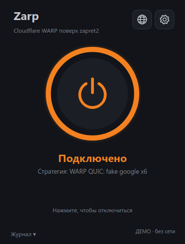
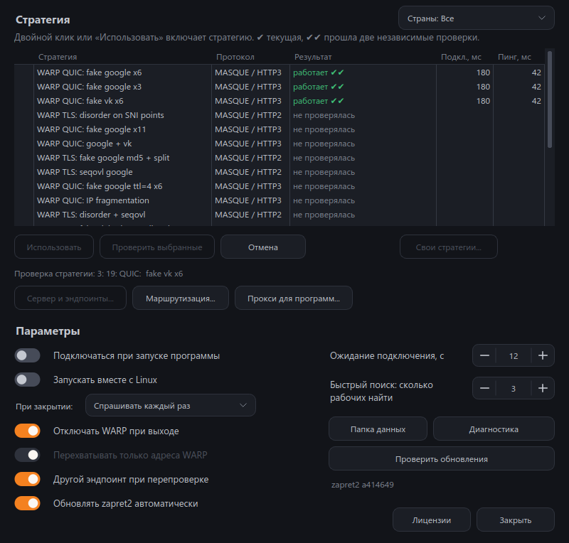

<p align="center">
  
</p>

<h1 align="center">Zarp for Linux</h1>

<p align="center">
  Cloudflare WARP и ваши VPN-серверы через zapret2.
  <br>
  Одна кнопка, автоматический поиск стратегии и проверка соединения.
</p>

<p align="center">
  <a href="https://github.com/ZarpVPN/Zarp-Linux/actions/workflows/build.yml"></a>
  <a href="https://github.com/ZarpVPN/Zarp-Linux/releases/latest"></a>
  <a href="LICENSE"></a>
  
</p>

Zarp подбирает стратегию [zapret2](https://github.com/bol-van/zapret2), которая помогает подключить WARP в сети с DPI, проверяет соединение и сохраняет результат. Можно использовать собственный VLESS, Trojan, Hysteria2 или XHTTP-сервер: его внешнее соединение также проходит через zapret2.

<p align="center">
  
  
  <br>
  <sub>Интерфейс в автономном деморежиме. Результаты на снимках смоделированы.</sub>
</p>

## Скачать

Пакеты публикуются в [GitHub Releases](https://github.com/ZarpVPN/Zarp-Linux/releases). Релиз содержит версии для каждой системы и файл `SHA256SUMS`.

| Система | Пакет | Требования |
| --- | --- | --- |
| **Ubuntu 26.04** | [zarp-ubuntu-amd64.deb](https://github.com/ZarpVPN/Zarp-Linux/releases/latest/download/zarp-ubuntu-amd64.deb) | x86_64, systemd |
| **Debian 13** | [zarp-debian-amd64.deb](https://github.com/ZarpVPN/Zarp-Linux/releases/latest/download/zarp-debian-amd64.deb) | x86_64, systemd |
| **Fedora 44** | [zarp-fedora-x86_64.rpm](https://github.com/ZarpVPN/Zarp-Linux/releases/latest/download/zarp-fedora-x86_64.rpm) | x86_64, systemd |
| **Arch Linux** | [zarp-arch-x86_64.pkg.tar.zst](https://github.com/ZarpVPN/Zarp-Linux/releases/latest/download/zarp-arch-x86_64.pkg.tar.zst) | актуальная система, x86_64, systemd |

Другие платформы: [Windows](https://github.com/ZarpVPN/Zarp) · [macOS](https://github.com/ZarpVPN/Zarp-MacOS) · [Android](https://github.com/ZarpVPN/Zarp-Android).

## Установка

Скачайте пакет своей системы и установите его:

```sh
# Ubuntu
sudo apt install ./zarp-ubuntu-amd64.deb

# Debian
sudo apt install ./zarp-debian-amd64.deb

# Fedora
sudo dnf install ./zarp-fedora-x86_64.rpm

# Arch Linux
sudo pacman -U ./zarp-arch-x86_64.pkg.tar.zst
```

Запустите службу и откройте приложение из меню или терминала:

```sh
sudo systemctl enable --now zarp.service
zarp
```

Интерфейс работает от обычного пользователя. Системная служба управляет перехватом пакетов и туннелем; доступ к ней проверяется через polkit.

**Cloudflare WARP:** Zarp использует официальный клиент. На Ubuntu и Debian он устанавливается приложением после принятия условий Cloudflare. На Arch и Fedora официальный клиент нужно установить отдельно. WARP не входит в пакеты Zarp.

## Возможности

- **Подключение одной кнопкой.** При первом запуске Zarp ищет рабочую стратегию, затем использует сохранённые результаты.
- **WARP через zapret2.** MASQUE поверх QUIC / HTTP/3 и TLS / HTTP/2. Регистрация устройства также защищается zapret2.
- **Быстрый и полный поиск.** Каждая рабочая стратегия проверяется повторно; при включённой изоляции используется другой endpoint.
- **Проверка трафика.** Статуса «Подключено» от WARP недостаточно: проверяется HTTPS через туннель и применение стратегии.
- **Собственные серверы.** VLESS TLS / Reality, Trojan, Hysteria2 и VLESS XHTTP, отдельные ссылки и подписки. Подробности в [настройках подключения](docs/connection-settings.md).
- **Маршрутизация.** Правила Direct, Proxy и Block, пресеты локальных сетей, России, Ирана и Китая, выбор программ для собственного сервера.
- **WARP+.** Привязка существующей лицензии через официальный клиент с защищёнными запросами.
- **Свои стратегии.** Редактирование профилей zapret2, фильтрация по странам и проверка выбранных строк.
- **Обновления zapret2.** Проверка опубликованного SHA-256 и конфигурации перед активацией. Поставляемый runtime сохраняется для восстановления.
- **Привычный интерфейс.** Анимированная кнопка подключения, отдельное окно настроек, журнал, языки и системный трей.

## Как пользоваться

1. Нажмите кнопку подключения или откройте настройки и запустите поиск.
2. **Быстрый поиск** останавливается после нужного количества подтверждённых стратегий. **Полный поиск** проверяет весь список.
3. Для ручного выбора нажмите на строку дважды или используйте кнопку **«Использовать»**.

Зелёный результат означает успешную повторную проверку. Синий показывает первый успешный проход, красный обозначает ошибку, серый показывает ещё не проверенную стратегию. Наведите курсор на результат, чтобы прочитать сообщение полностью.

Количество рабочих стратегий зависит от сети. Zarp проверяет фактическое соединение и не считает успешным неподтверждённый туннель. На малом MTU используется компактный VK Initial с сохранённым ClientHello; фрагментация учитывает firewall официального WARP.

## Сборка и разработка

Нужны Linux, Go 1.24+, Python 3, PySide6 и инструменты сборки nfqws2. Список пакетов для каждой системы приведён в [руководстве по сборке](docs/building.md).

```sh
make runtime
make build
make test
make package
```

Демонстрация без сети и изменений VPN:

```sh
make demo
```

- [Сборка и автоматические релизы](docs/building.md)
- [Тестирование](docs/testing.md)
- [Настройки подключения](docs/connection-settings.md)
- [Сторонние компоненты](THIRD_PARTY_NOTICES.md)

## Поддержка

[Сообщить об ошибке](https://github.com/ZarpVPN/Zarp-Linux/issues) · [Сообщество Zarp](https://github.com/orgs/ZarpVPN/discussions).

В описании проблемы укажите дистрибутив, версию Zarp, стратегию и текст ошибки. Не публикуйте приватные ключи, лицензии WARP+ и ссылки подписок.

## Конфиденциальность

Zarp не отправляет телеметрию. Настройки и учётные данные хранятся локально; управление службой доступно через локальный Unix-сокет с проверкой прав. При подключении используются выбранный VPN-провайдер и проверочные HTTPS-адреса. Проверка обновлений обращается к GitHub, установка WARP использует официальный репозиторий Cloudflare.

## Лицензия

Код Zarp распространяется под [MIT](LICENSE). Лицензии zapret2, sing-box, Xray, шрифтов и других включённых компонентов перечислены в [THIRD_PARTY_NOTICES.md](THIRD_PARTY_NOTICES.md).

Cloudflare и WARP принадлежат Cloudflare, Inc. Zarp является независимым проектом и не связан с Cloudflare. Проприетарный клиент WARP не распространяется вместе с Zarp.
