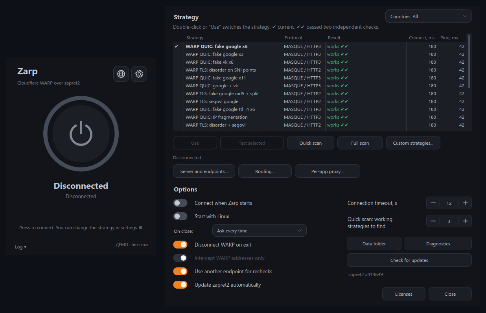

# Zarp

[](https://github.com/ZarpVPN/Zarp-Linux/actions/workflows/build.yml)
[](https://github.com/ZarpVPN/Zarp-Linux/releases/latest)
[](LICENSE)

One-click Cloudflare WARP for Linux networks that block it. Zarp finds a [zapret2](https://github.com/bol-van/zapret2) strategy that gets the WARP handshake through DPI, remembers it and connects. You can also put zapret2 in front of your own VLESS, Trojan, Hysteria2 or XHTTP server, with routing rules and a choice of programs. Native packages are available for Ubuntu, Debian, Fedora and Arch Linux.



*The screenshot shows the offline demo; connection results are simulated.*

## Download

| Platform | Download | Requirements |
|---|---|---|
| **Ubuntu** | [**DEB**](https://github.com/ZarpVPN/Zarp-Linux/releases/latest/download/zarp-ubuntu-amd64.deb) | Ubuntu 26.04, x86_64, systemd |
| **Debian** | [**DEB**](https://github.com/ZarpVPN/Zarp-Linux/releases/latest/download/zarp-debian-amd64.deb) | Debian 13, x86_64, systemd |
| **Fedora** | [**RPM**](https://github.com/ZarpVPN/Zarp-Linux/releases/latest/download/zarp-fedora-x86_64.rpm) | Fedora 44, x86_64, systemd |
| **Arch Linux** | [**Package**](https://github.com/ZarpVPN/Zarp-Linux/releases/latest/download/zarp-arch-x86_64.pkg.tar.zst) | Current Arch Linux, x86_64, systemd |

[All Linux releases](https://github.com/ZarpVPN/Zarp-Linux/releases) · [Windows](https://github.com/ZarpVPN/Zarp) · [macOS](https://github.com/ZarpVPN/Zarp-MacOS) · [Android](https://github.com/ZarpVPN/Zarp-Android)

## 💬 Community & Support

Have questions, ideas, or feedback? Join our [Zarp Community](https://github.com/orgs/ZarpVPN/discussions)!

- ❓ Ask questions and get help
- 💡 Suggest new features
- 📢 Follow announcements
- 🗳️ Vote on upcoming improvements

Found a bug? [Open an issue](https://github.com/ZarpVPN/Zarp-Linux/issues) with your distribution, Zarp version, strategy and error message.

## Features

- **One button.** The first click searches for a working strategy; later clicks use the saved results.
- **Built for WARP.** Strategies target the WARP handshake: MASQUE over QUIC (HTTP/3) and over TLS (HTTP/2). Device registration also goes through zapret2.
- **Repeated checks.** A strategy must pass twice. When test isolation is enabled, the second check uses another WARP endpoint. A connection counts only if HTTPS traffic passes through the tunnel and the strategy is applied.
- **Quick and full scan.** Quick scan stops after the selected number of confirmed strategies. Full scan tests the whole list. You can also recheck selected rows or choose a strategy manually.
- **Your own server.** VLESS TLS / Reality, Trojan, Hysteria2 and VLESS XHTTP, from a single link or an HTTPS subscription. The outer connection to the selected server goes through zapret2 while the tunnel is up. [sing-box](https://github.com/SagerNet/sing-box) handles the tunnel; [Xray-core](https://github.com/XTLS/Xray-core) handles XHTTP through a local bridge.
- **Routing and per-program proxy** (your own server). Direct, Proxy and Block rules, GeoIP/GeoSite, country and local-network presets, and a choice of programs. See [connection settings](docs/connection-settings.md).
- **WARP+ subscriptions.** Apply an existing WARP+ license through the official client. The request is protected by zapret2, and the WARP client keeps the license.
- **Countries and custom strategies.** Filter strategies by country, add your own profiles and keep their verified results.
- **Verified runtime.** Packages include zapret2, sing-box and Xray. Downloads are pinned and checked; zapret2 updates are validated before activation, with the bundled runtime kept for recovery.
- **Your language.** English, Русский, Español, Português, 中文, हिन्दी, Français, Deutsch and فارسی. The globe button switches the interface language. The compact interface includes the animated power button, settings, log and system tray.

## Requirements

- Ubuntu 26.04, Debian 13, Fedora 44 or current Arch Linux, x86_64.
- systemd, nftables and an interactive polkit agent. The GUI runs as your ordinary user; a system service handles packet interception and tunnels.
- Kernel support for NFQUEUE and cgroup v2. WARP interception needs `nft_socket` or the `xt_cgroup` compatibility path with `iptables-nft`.
- The official [Cloudflare WARP client](https://one.one.one.one/) for WARP mode. On Ubuntu and Debian, Zarp can install it after you accept Cloudflare's terms. On Fedora and Arch, install the client separately. Your own server mode uses the bundled VPN engines.

Packages are built natively for the systems above. Older distributions, ARM64 and systems without systemd are not covered by these builds.

## Usage

1. Download the package for your distribution and install it.
2. Start the Zarp service and open Zarp from the application menu.
3. Press the power button. Change the strategy or run a full scan in Settings.

<details>
<summary>Package installation commands</summary>

```sh
# Ubuntu
sudo apt install ./zarp-ubuntu-amd64.deb

# Debian
sudo apt install ./zarp-debian-amd64.deb

# Fedora
sudo dnf install ./zarp-fedora-x86_64.rpm

# Arch Linux
sudo pacman -U ./zarp-arch-x86_64.pkg.tar.zst
```

Then start the service and application:

```sh
sudo systemctl enable --now zarp.service
zarp
```

</details>

**No Cloudflare WARP yet?** On Ubuntu and Debian, accept the installation prompt. Zarp downloads the official client from Cloudflare, verifies the signed package metadata and installs it. If ordinary download attempts fail, it retries through zapret2. The proprietary WARP client is not bundled with Zarp. On Fedora and Arch, install it separately before using WARP mode.

**Quick scan** stops after enough confirmed strategies are found; the number is adjustable. **Full scan** checks every candidate. Double-click a row or press **Use** to select a strategy. Green results are confirmed; blue results have passed once, red results failed, and grey rows have not been tested. Hover over a result to read the full message.

**Server and endpoints**, **Routing**, **Per-app proxy** and **WARP+** are described in [connection settings](docs/connection-settings.md). Routing rules and program selection apply to your own server; WARP uses the official client's system tunnel.

### Verify the download

Each release includes `SHA256SUMS` and `release-manifest.json`, with package hashes, the source commit and runtime versions. Download `SHA256SUMS` alongside your package and run:

```sh
sha256sum --check SHA256SUMS --ignore-missing
```

## How it works

The desktop interface talks to the local Zarp service over a Unix socket with polkit authorization. The service starts `nfqws2`, installs scoped nftables rules, connects the official WARP client and checks real HTTPS traffic through the tunnel. Searching and registering WARP use separate protected flows; a successful registration does not mark a tunnel strategy as working.

With your own server, a candidate is a pair of a server and a compatible zapret2 strategy. Zarp checks the pair, starts the sing-box tunnel with your routing rules and keeps intercepting the outer connection to that server. XHTTP uses Xray as a local bridge behind sing-box.

## Building

```sh
make runtime
make build
make test
make package
```

Requires Go 1.24+, Python 3, PySide6 and native nfqws2 build dependencies. See [building and releases](docs/building.md) for the package list for each distribution. `make demo` opens an offline demonstration without changing your network or WARP account.

[GitHub Actions](.github/workflows/build.yml) builds Ubuntu, Debian, Fedora and Arch packages independently. A matching `v*` tag publishes a release after all four builds and checks pass. Checks cover Go/race, the GUI, runtime integrity and real packet handling in an isolated network namespace. See [testing](docs/testing.md).

## Privacy

Zarp has no telemetry. Settings and credentials stay on your machine. Connections use your selected VPN provider and HTTPS connectivity checks. Update checks contact GitHub; WARP installation downloads from Cloudflare's official repository. Subscriptions and optional GeoIP/GeoSite downloads use the addresses you configure.

## License

Zarp for Linux is released under the [MIT License](LICENSE). Licenses and source links for zapret2, sing-box, Xray, fonts and bundled data are listed in [THIRD_PARTY_NOTICES.md](THIRD_PARTY_NOTICES.md).

Cloudflare and WARP are trademarks of Cloudflare, Inc. Zarp is an independent project, not affiliated with or endorsed by Cloudflare. Zarp does not bundle or redistribute the proprietary Cloudflare WARP client.
